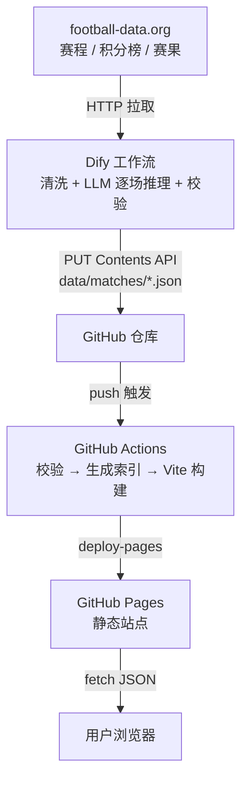
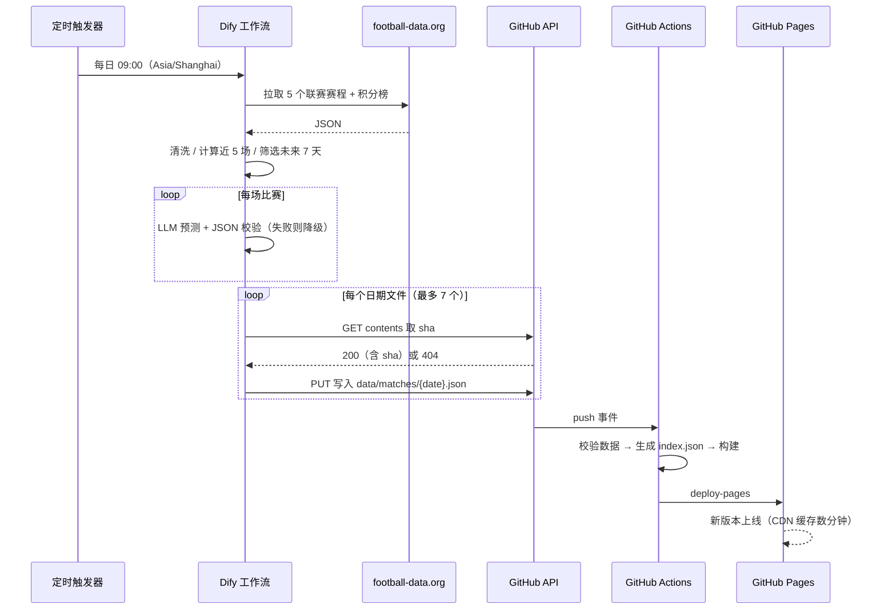
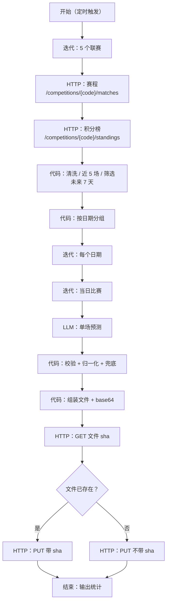

# 五大联赛赛前预测站 · 技术设计方案

| 项目 | 内容 |
| --- | --- |
| 版本 | v1.0（草案，待评审） |
| 日期 | 2026-11-23 |
| 站点形态 | 纯静态站点（GitHub Pages） |
| 预测来源 | Dify 工作流（独立部署） |
| 数据通道 | Dify → GitHub Contents API → GitHub Actions → Pages |
| 首版范围 | 比赛列表 + 比赛详情（赛果回填与命中率放 v1.1） |

---

## 1. 目标与边界

### 1.1 目标

1. 展示英超、西甲、意甲、德甲、法甲未来 7 天比赛的赛前预测。
2. 预测内容包括：胜/平/负概率、预测比分、信心度、预测理由、关键因素、风险提示。
3. 站点零后端、零运行时依赖，纯静态部署在 GitHub Pages。
4. Dify 工作流与站点完全解耦：Dify 停止运行不影响站点访问，站点改版不影响预测产出。
5. 数据更新链路全自动：Dify 定时运行 → 提交 JSON → Actions 校验构建 → 自动上线。

### 1.2 非目标（首版明确不做）

- 不做实时比分直播（免费数据源本身有延迟，且与"赛前预测"定位无关）。
- 不做用户系统、登录、收藏、评论。
- 不做任何投注、赔率交易、返佣入口。
- 不做移动端 App / 小程序。
- 不做多语言（首版仅简体中文，数据结构预留英文队名）。
- 不做服务端搜索、数据库、CMS。

### 1.3 关键约束

| 约束 | 说明 |
| --- | --- |
| 数据源配额 | football-data.org 免费版 10 次/分钟，必须避免逐队请求 |
| Dify 只写不改 | Dify 只负责写 `data/` 下文件，不维护索引、不构建站点 |
| 构建产物可回滚 | 任意一次数据提交都可 revert，线上回到上一版 |
| 坏数据不发布 | 校验失败时中止部署，线上保持上一版 |

---

## 2. 总体架构



### 2.1 组件职责

| 组件 | 职责 | 不负责 |
| --- | --- | --- |
| football-data.org | 提供赛程、积分榜、赛果原始数据 | 不做预测 |
| Dify 工作流 | 采集、清洗、推理、校验、提交数据文件 | 不生成页面、不维护索引、不部署 |
| GitHub 仓库 | 唯一事实源：预测数据 + 站点源码 | 不做计算 |
| GitHub Actions | 数据校验、索引与统计生成、站点构建、部署 | 不产生预测 |
| GitHub Pages | 托管 `dist` 静态产物 | 无运行时逻辑 |
| 浏览器 | 读取 JSON、渲染、筛选、路由 | 不调用 Dify、不持有密钥 |

### 2.2 每日运行时序



### 2.3 解耦点

整个系统只有两个耦合点，改任何一侧都不需要动另一侧：

1. **数据契约**：`data/matches/{YYYY-MM-DD}.json` 的字段结构（见第 4 章）。
2. **触发方式**：向 `data/**` 提交文件即触发部署（见第 6 章）。

---

## 3. 关键设计决策

| 编号 | 决策 | 备选方案 | 选择理由 |
| --- | --- | --- | --- |
| D1 | 站点与 Dify 分离部署，站点不调用 Dify API | 前端直连 Dify API | 避免密钥暴露；Dify 停机不影响站点；静态站无冷启动 |
| D2 | JSON 文件作为唯一事实源，提交进 Git | Dify 存对象存储，前端拉 OSS | 版本可追溯、可回滚、无需额外账号与费用；数据量极小 |
| D3 | 一天一个文件 `matches/{date}.json` | 单文件 `latest.json` 全量快照 | 单文件会无限增长且覆盖写有竞态；按天文件可按需加载、可归档 |
| D4 | 索引与统计由 Actions 生成 | Dify 维护 index.json | 避免 Dify 多次提交互相覆盖 index；索引是派生数据，不该由生产者维护 |
| D5 | 站点运行时 fetch JSON | 构建期把 JSON 内联进 bundle | 运行时读取让数据更新与代码发布解耦，构建不会因坏数据失败 |
| D6 | Vue Router 使用 hash 模式 | History 模式 + 404.html 回退 | Pages 无需额外回退配置，深链刷新不 404 |
| D7 | 数据文件目录在仓库根，构建时复制到 `web/public/data` | 直接把 data 放 `web/public` | 保持"数据归数据、前端归前端"，Dify 路径稳定 |
| D8 | 校验脚本零依赖（Node 内置模块） | 引入 Ajv + JSON Schema | 减少 Actions 安装步骤和依赖风险，规则数量可控 |
| D9 | 预测失败降级为排名先验，而不是丢弃比赛 | 直接跳过失败比赛 | 保证页面完整；`degraded` 标记让用户知情 |

---

## 4. 数据契约

### 4.1 目录与命名

```
data/
├─ matches/
│  ├─ 2026-11-24.json        # 预测结果（Dify 写入）
│  └─ 2026-11-25.json
├─ results/
│  └─ 2026-11-20.json        # 赛果回填（v1.1，Dify 写入）
├─ index.json                # Actions 生成，gitignore
└─ stats.json                # Actions 生成，gitignore（v1.1）
```

规则：

- 文件名日期 = 比赛开赛时间换算到 `Asia/Shanghai` 后的自然日。
- `index.json`、`stats.json` 不提交仓库，避免与 Actions 生成版本冲突。
- 所有 JSON 使用 UTF-8、2 空格缩进、末尾换行。

### 4.2 `matches/{date}.json`

```json
{
  "schemaVersion": 1,
  "date": "2026-11-24",
  "generatedAt": "2026-11-23T09:12:31+08:00",
  "source": "football-data.org",
  "model": "gpt-4o-mini",
  "promptVersion": "2026-11-26-a",
  "matchCount": 1,
  "degradedCount": 0,
  "matches": [
    {
      "id": "PL-2026-11-24-ARS-CHE",
      "league": "PL",
      "leagueName": "英超",
      "kickoff": "2026-11-24T20:00:00Z",
      "status": "scheduled",
      "matchday": 13,
      "venue": "Emirates Stadium",
      "home": {
        "name": "阿森纳",
        "nameEn": "Arsenal",
        "rank": 1,
        "form": ["W", "W", "D", "L", "W"],
        "goalsFor": 28,
        "goalsAgainst": 11
      },
      "away": {
        "name": "切尔西",
        "nameEn": "Chelsea",
        "rank": 5,
        "form": ["W", "D", "W", "W", "L"],
        "goalsFor": 23,
        "goalsAgainst": 16
      },
      "prediction": {
        "prob": { "home": 52, "draw": 26, "away": 22 },
        "score": { "home": 2, "away": 1 },
        "confidence": 74,
        "pick": "home",
        "reasons": [
          "主场近 5 场 4 胜 1 平，场均进球 2.4",
          "对手近 3 个客场均有失球",
          "积分榜领先 4 分，阵容稳定性更高"
        ],
        "factors": ["主场优势", "控球率差 +11%", "对手中卫停赛"],
        "risk": "德比战波动大，双方近 5 次交锋 3 次打平"
      },
      "injuries": {
        "date": "2026-11-23",
        "home": [],
        "away": [{ "player": "R. Bardghji", "type": "Missing Fixture", "reason": "Knee Injury" }]
      },
      "degraded": false,
      "result": null
    }
  ]
}
```

字段说明：

| 字段 | 类型 | 必填 | 约束 | 说明 |
| --- | --- | --- | --- | --- |
| `schemaVersion` | number | 是 | 固定 `1` | 结构版本，变更时递增 |
| `date` | string | 是 | `YYYY-MM-DD`，须与文件名一致 | 北京日期 |
| `generatedAt` | string | 是 | ISO 8601 含时区 | 生成时间 |
| `source` | string | 是 | — | 原始数据来源标识 |
| `model` | string | 是 | — | 实际使用的模型名 |
| `promptVersion` | string | 否 | — | 提示词版本标记，修改提示词时同步递增；旧文件可能缺失，复盘时用于区分批次 |
| `matchCount` | number | 是 | 等于 `matches.length` | 便于快速巡检 |
| `degradedCount` | number | 是 | 降级场次数 | 监控指标 |
| `matches[].id` | string | 是 | 全局唯一 | `{league}-{date}-{主队码}-{客队码}` |
| `matches[].league` | string | 是 | `PL/PD/SA/BL1/FL1` | 联赛代码 |
| `matches[].leagueName` | string | 是 | — | 中文联赛名 |
| `matches[].kickoff` | string | 是 | ISO 8601 UTC | 开赛时间 |
| `matches[].status` | string | 是 | `scheduled` | 首版只收录未开赛比赛 |
| `matches[].matchday` | number | 否 | — | 轮次 |
| `matches[].venue` | string | 否 | — | 球场 |
| `matches[].home/away` | object | 是 | 见下 | 球队信息 |
| `home/away.name` | string | 是 | 非空 | 中文队名 |
| `home/away.nameEn` | string | 是 | 非空 | 英文队名（预留） |
| `home/away.rank` | number | 是 | ≥1 | 积分榜排名 |
| `home/away.form` | string[] | 是 | 元素 ∈ `W/D/L`，长度 ≤5 | 最近 5 场（新的在前） |
| `home/away.goalsFor` | number | 否 | ≥0 | 本赛季进球 |
| `home/away.goalsAgainst` | number | 否 | ≥0 | 本赛季失球 |
| `prediction.prob` | object | 是 | 三项均为 1–98 整数，和 = 100 | 胜平负概率 |
| `prediction.score` | object | 是 | 0–9 整数 | 预测比分 |
| `prediction.confidence` | number | 是 | 0–100 整数 | 信心度 |
| `prediction.pick` | string | 是 | `home/draw/away` | 与 prob 最大项一致 |
| `prediction.reasons` | string[] | 是 | 2–4 条，每条 ≤40 字 | 预测理由 |
| `prediction.factors` | string[] | 否 | ≤5 条 | 关键因素 |
| `prediction.risk` | string | 否 | ≤60 字 | 风险提示，可为空串 |
| `matches[].injuries` | object | 否 | — | 伤停名单快照，仅覆盖开赛前 3 天窗口；窗口外或该日无名单时缺失 |
| `injuries.date` | string | 否 | `YYYY-MM-DD` | 名单对应日期（UTC 开球日） |
| `injuries.home/away` | object[] | 否 | ≤5 条/队 | 每项含 `player`、`type`、`reason` |
| `degraded` | boolean | 是 | — | 是否使用了兜底预测 |
| `result` | object\|null | 是 | 首版恒为 `null` | 赛果，v1.1 回填 |

### 4.3 `results/{date}.json`（v1.1）

只追加、不回写历史预测文件，前端按 `id` 关联。

```json
{
  "schemaVersion": 1,
  "date": "2026-11-20",
  "generatedAt": "2026-11-21T08:40:00+08:00",
  "results": [
    {
      "id": "PL-2026-11-20-ARS-CHE",
      "homeGoals": 2,
      "awayGoals": 1,
      "outcome": "home",
      "status": "FT",
      "updatedAt": "2026-11-21T08:40:00+08:00"
    }
  ]
}
```

`outcome` 取值 `home/draw/away`，命中判断：`outcome === prediction.pick`；比分命中：`homeGoals/awayGoals` 与 `prediction.score` 完全一致。

### 4.4 `index.json`（Actions 生成）

```json
{
  "schemaVersion": 1,
  "updatedAt": "2026-11-23T09:20:00+08:00",
  "latest": "2026-11-24",
  "earliest": "2026-11-23",
  "dates": ["2026-11-23", "2026-11-24", "2026-11-25"],
  "resultDates": [],
  "fixtureDates": ["2026-11-27", "2026-11-28"],
  "leagues": [
    { "code": "PL", "name": "英超" },
    { "code": "PD", "name": "西甲" },
    { "code": "SA", "name": "意甲" },
    { "code": "BL1", "name": "德甲" },
    { "code": "FL1", "name": "法甲" }
  ]
}
```

### 4.5 `stats.json`（Actions 生成，v1.1）

```json
{
  "schemaVersion": 1,
  "updatedAt": "2026-11-23T09:20:00+08:00",
  "overall": { "total": 120, "outcomeHit": 63, "outcomeRate": 52.5, "scoreHit": 11, "scoreRate": 9.2 },
  "byLeague": [
    { "league": "PL", "total": 24, "outcomeHit": 13, "outcomeRate": 54.2, "scoreHit": 2, "scoreRate": 8.3 }
  ]
}
```

### 4.6 时区与日期规则

- 存储统一使用 UTC ISO 8601（带 `Z`）。
- 文件名与页面日期统一使用 `Asia/Shanghai`。
- 转换公式：`date = toZonedTime(kickoff, 'Asia/Shanghai')`。
- 凌晨 00:00–06:00（北京时间）开赛的比赛归入当天，不跨日。

### 4.7 标识与去重

- 比赛 `id` 由工作流基于 football-data.org 的 `match.id` 生成，写入时附带原始 id 到 `sourceId`（可选字段）便于排查。
- 同一天文件重复生成时按 `id` 去重，后者覆盖前者。
- 文件级幂等：同一天多次运行 → 相同路径覆盖写。

---

### 4.8 `fixtures/{date}.json`（仅赛程）

预测窗口为未来 3 天，赛程窗口为未来 30 天。没有预测的日期写入 `data/fixtures/{date}.json`，只含展示所需字段：

```json
{
  "schemaVersion": 1,
  "date": "2026-12-15",
  "generatedAt": "2026-11-28T06:00:00+08:00",
  "matchCount": 2,
  "matches": [
    {
      "id": "PL-2026-12-15-ARS-CHE",
      "league": "PL",
      "leagueName": "英超",
      "kickoff": "2026-12-15T20:00:00Z",
      "home": { "name": "阿森纳", "crest": "...", "rank": 1 },
      "away": { "name": "切尔西", "crest": "...", "rank": 5 }
    }
  ]
}
```

- 有预测的日期只写 `matches/{date}.json`，不重复写 fixtures。
- `index.json` 的 `fixtureDates` 列出仅有赛程的日期，`dates` 仍为有预测的日期；首页日期条合并两者展示，无预测日期淡化。
- 未预测场次使用只读卡片，不可点击，显示「赛前 3 天开放」。
- 工作流按 `code_build.path` 决定写入 `data/matches/` 还是 `data/fixtures/`，提交链路共用。

### 4.9 历史预测保留

- `matches/{date}.json` 按日期整份覆盖，赛前最后一次运行的内容即为最终版。
- 窗口外的历史文件不删除，作为复盘样本保留。
- 索引只登记当前窗口内的日期，历史日期不进首页日期条。
- 数据量持续累积，达到技术方案 12.4 的阈值后按赛季归档。

## 5. Dify 工作流设计

### 5.1 前置准备

| 项 | 说明 |
| --- | --- |
| football-data.org 账号 | 获取 `X-Auth-Token`；免费版可访问五大联赛赛程与积分榜 |
| GitHub fine-grained PAT | 仅勾选目标仓库 `Contents: Read and write`、`Metadata: Read` |
| 仓库 | 站点仓库（如 `yourname/footballcoin`），默认分支 `main` |
| Dify 变量 | `FD_TOKEN`、`GH_TOKEN`、`GH_OWNER`、`GH_REPO`、`GH_BRANCH`、`GH_PATH_PREFIX` |

所有密钥只存在于 Dify 的变量/密钥管理中，不写入提示词、不写入仓库、不下发前端。

### 5.2 工作流节点图



> 说明：Dify 的 `迭代` 节点支持嵌套，但为降低复杂度，可以把「联赛迭代」和「日期迭代」拆成两个串行迭代；单场 LLM 迭代放在日期迭代内部。

### 5.3 节点明细

| # | 节点名 | 类型 | 关键配置 | 输出 |
| --- | --- | --- | --- | --- |
| 1 | 开始 | 开始 | 触发方式：定时；cron `0 9 * * *`，时区 `Asia/Shanghai` | — |
| 2 | 联赛列表 | 代码 | 常量数组 `["PL","PD","SA","BL1","FL1"]` | `leagues` |
| 3 | 联赛迭代 | 迭代 | 输入 `leagues`；并发 1（避免触发限流） | 每个联赛的原始数据 |
| 4 | 拉赛程 | HTTP | `GET https://api.football-data.org/v4/competitions/{code}/matches?dateFrom={-45d}&dateTo={+10d}`；Header `X-Auth-Token` | `matches` |
| 5 | 拉积分榜 | HTTP | `GET https://api.football-data.org/v4/competitions/{code}/standings` | `standings` |
| 6 | 清洗与筛选 | 代码 | 合并两路数据；计算近 5 场；过滤 `status in [SCHEDULED, TIMED]`；`now <= kickoff <= now+7d`；统一字段 | `matchList` |
| 7 | 按日期分组 | 代码 | 按北京时间日期分组为 `[{date, matches[]}]` | `days` |
| 8 | 日期迭代 | 迭代 | 输入 `days`；并发 1 | 单个日期 |
| 9 | 比赛迭代 | 迭代 | 输入当日 `matches`；并发 3（LLM 限流可调） | 单场上下文 |
| 10 | 单场预测 | LLM | 模型见 5.10；temperature 0.2；开启 JSON 输出 | 原始文本 |
| 11 | 校验与兜底 | 代码 | JSON 解析、概率归一、字段兜底、失败降级（见 5.7） | 标准化 `prediction` |
| 12 | 组装文件 | 代码 | 合并当日结果；生成 `generatedAt`、`matchCount`、`degradedCount`；base64 编码 | `contentBase64`、`commitMessage` |
| 13 | 查询 sha | HTTP | `GET /repos/{owner}/{repo}/contents/data/matches/{date}.json`；非 2xx 视为不存在 | `sha` 或空 |
| 14 | 条件分支 | IF/ELSE | `sha` 非空 → 分支 A；为空 → 分支 B | — |
| 15A | 覆盖提交 | HTTP | `PUT` 同上路径，Body 含 `sha` | 提交结果 |
| 15B | 新建提交 | HTTP | `PUT` 同上路径，Body 不含 `sha` | 提交结果 |
| 16 | 结束 | 结束 | 输出 `submittedDates`、`failedDates`、`degradedCount` | — |

### 5.4 数据采集策略（配额控制）

关键点：**不要逐队请求近期比赛**，否则 20 队 × 5 联赛会直接打爆免费额度。

| 请求 | 次数/天 | 说明 |
| --- | --- | --- |
| `competitions/{code}/matches` | 5 | 预测范围内赛事，用 55 天窗口，一次拿到已结束 + 未来比赛 |
| `competitions/{code}/standings` | 5 | 排名与赛季进失球 |
| `competitions/{code}/matches`（参考池） | 1~5 | 只拉预测范围外、需要作为跨赛事参考的赛事；不拉积分榜、不产生预测 |
| 合计 | 7~11 | 随 `COMPETITION_SET` 变化，见下表 |

| `COMPETITION_SET` | 主链路 | 参考池 | 合计 |
| --- | --- | --- | --- |
| `domestic` | 5 联赛 × 2 = 10 | 欧冠赛程 1 | 11 |
| `europe` | 欧冠 × 2 = 2 | 五大联赛赛程 5 | 7 |
| `all` | 6 赛事 × 2 = 12 | 无 | 12（必然超限，建议拆成两次运行） |

近 5 场状态、主客场拆分、进失球全部在代码节点里从赛程数组计算，不额外发请求；跨赛事统计复用参考池赛程。

请求头：

```
X-Auth-Token: {{env.FD_TOKEN}}
Accept: application/json
```

限流处理：

- 联赛迭代并发设为 1，每个联赛请求之间天然间隔。
- 实测免费层额度：连续请求 11 次可用，第 12 次返回 `429`，`X-RequestCounter-Reset` 为 60 秒窗口。
- 参考池迭代放在资讯合并之后、单场统计之前，与主链路拉取相隔一分钟以上，避开同一限流窗口。
- 参考池迭代为 `continue-on-error`：单个赛事 429 只让该赛事的跨赛事数据缺失，不中断整次运行。
- 主链路联赛迭代同样是 `continue-on-error`，但普通 HTTP 节点没有错误兜底，因此不要把额外的赛事请求放在迭代之外。
- `all` 模式 12 次无法错峰，必须拆成 `domestic` 和 `europe` 两次运行。

伤病数据（API-Football）：

- 接口 `/injuries?date=` 按 UTC 日期划分赛程，一次只能查一天，所以由迭代节点逐日拉取。
- 查询日期不再写死「UTC 明天」，而是从本次待预测赛程反推：取出所有比赛的开球 UTC 日期、去重排序后取最近 3 天，远期比赛不浪费额度。
- 整理节点按「日期|球队」拼键合并多天结果；挂载与提示词都按该场自身的开球 UTC 日期取名单，不再做全局日期相等判断。原先「UTC 明天」在运行时间跨过 UTC 零点后会整体错位，导致伤病全部被丢弃。

### 5.5 提示词

**System Prompt：**

```text
你是足球赛前预测分析师。你会收到一场比赛的结构化事实，请输出一份可解释的赛前预测。

必须遵守：
1. 只输出一个 JSON 对象，不要 Markdown 代码块，不要任何解释性文字。
2. prob 的 home/draw/away 必须是 1 到 98 的整数，三者之和必须等于 100。
3. score 的主客进球数必须是 0 到 9 的整数，且要与 prob 的倾向一致。
4. confidence 是 0 到 100 的整数；只有在数据充分、双方实力差距明显时才高于 80。
5. reasons 输出 2 到 4 条，每条不超过 40 字，必须引用给定事实；伤病、交手记录、天气只能使用输入中对应字段，标注未提供时不得编造。
6. factors 输出 1 到 5 条关键词短语，每条不超过 12 字。
7. risk 用一句话说明最大不确定性，不超过 60 字。
8. 如果关键数据缺失（例如排名缺失、近期比赛不足 3 场），必须在 risk 中说明，并把 confidence 控制在 55 以下。
9. 使用简体中文，球队名必须与输入完全一致，不要改写或翻译。
10. 若输入提供了市场赔率，只能引用其中的数值，不得编造。市场共识只是参照基线，不是标准答案：当分析不支持市场时可以给出不同概率，但必须说明分歧依据。
11. risk 中只能描述输入里确实缺失的数据块（无伤停名单、无交手记录、无市场赔率、有效样本不足）；交手记录、天气、市场赔率、伤病只要输入已给出，就不得写成「未提供」「缺失」或「空白」。伤病有球员、类型与原因即视为完整，天气有气温、降水与风速即视为完整，不得以「缺少位置」「信息不足」「仅给…」评论输入字段的细化程度；场地不在输入范围内，不得在 risk 或 factors 中提到场地。
12. 输入分为「本赛事口径」与「跨赛事参考口径」：本赛事是主口径，跨赛事只用于判断强度、对抗类型与赛程消耗；不得把不同赛事的场均进球相加或平均，也不得用某队在某赛事的场均替换另一赛事的均值。
13. 跨赛事口径的作用随本场赛事变化：预测国内联赛时，欧冠数据只作实力上限与轮换消耗的参考；预测欧冠时，国内联赛数据样本更大、反映稳定实力，欧冠数据反映对手类型与欧战节奏。
14. 主客场拆分只在同一赛事内成立，不得把欧冠主场表现当作联赛主场表现，反之亦然；跨赛事样本不足 3 场或缺失时按「无跨赛事数据」处理，不得用同赛事均值填补，并在 risk 中说明。
15. reasons 中至少有一条必须基于「本赛事口径」的进失球或近 5 场比分（要引用具体的场均进失、总进失或某场比分），不得只复述排名与市场赔率。
16. 先分析、后定概率：必须先按「近期状态与进失球 → 主客场差异 → 伤停与赛程消耗 → 交手与天气」的顺序完成判断，最后才对照市场。prob 必须由这几步得出，不得直接复制市场数值。
17. 当某项概率与市场相差超过 8 个百分点时，reasons 中至少两条必须基于非市场数据的具体事实（进失球、某场比分、伤停、赛程、交手），否则不得偏离。
18. 既不得为了贴合市场而修改与数据一致的分析结论，也不得为了显得独立而给出没有依据的结论。

输出结构（严格按此键名，analysis 在 prob 之前）：
{
  "analysis": "一句话概括核心依据，不超过 60 字，须引用具体数据",
  "prob": {"home": 0, "draw": 0, "away": 0},
  "score": {"home": 0, "away": 0},
  "confidence": 0,
  "pick": "home|draw|away",
  "reasons": ["..."],
  "factors": ["..."],
  "risk": "..."
}
```

**User Prompt 模板：**

```text
比赛：{{home.name}}（主） vs {{away.name}}（客）
联赛：{{leagueName}}（{{league}}），第 {{matchday}} 轮
开赛：{{kickoffBeijing}}（北京时间）
积分排名：主队第 {{home.rank}}，客队第 {{away.rank}}
近 5 场：主队 {{home.form}}，客队 {{away.form}}
赛季进失球：主队 {{home.goalsFor}}/{{home.goalsAgainst}}，客队 {{away.goalsFor}}/{{away.goalsAgainst}}
交手记录（近 N 次）：主队 x 胜 / y 平 / 客队 z 胜；最近：日期 主队 比分 客队
天气（开赛时）：气温 ℃，降水概率 %，风速 km/h
伤病情况（API-Football，日期 名单）：...
【本赛事口径】
主队 本赛事（来源赛事 PL，样本 N 场）：场均进 a / 失 b，合计进 c / 失 d
  主场 M 场：场均进 a1 / 失 b1
  客场 K 场：场均进 a2 / 失 b2
  近 5 场（该队视角：主/客 进球-失球 对手 结果）：...
客队 本赛事：同上
【跨赛事参考口径】
主队 跨赛事（来源赛事 CL，样本 N 场）：场均进 a / 失 b，合计进 c / 失 d
  近 5 场（该队视角：主/客 进球-失球 对手 结果）：...
客队 跨赛事：...
【赛程密度】
主队：3.7 天前（2026-11-24 CL 客）、3.9 天后（2026-11-29 PD 客）
客队：前后 4 天内无其他赛事
市场共识（bookmaker，已去水；仅作参照，不是标准答案）：主胜 x% / 平局 y% / 客胜 z%
```

市场数据固定放在输入的最末尾，避免模型在阅读其他事实之前先被市场概率锚定。

各数据块缺失时的写法固定为「暂无该队场次数据」「暂无双方历史交锋数据」「未提供」，不使用空白或占位符填充。

### 5.5.1 进球口径与跨赛事优先级

**目标**：让单场预测不再只看「排名 + 近 5 场胜平负」，而是有真实的进球产出与失球暴露作依据；同时允许联赛与欧冠数据互相参考，但不做数值混算。

**原则**：统计口径由代码算准，取舍规则由提示词约束。

#### 数据源

| 赛事 | 用途 | 接口 |
| --- | --- | --- |
| PL / PD / SA / BL1 / FL1 | 预测对象 + 跨赛事参考 | `/competitions/{code}/matches`、`/standings` |
| CL | 预测对象 + 跨赛事参考 | 同上 |
| 参考赛事（按 `COMPETITION_SET` 决定） | 仅作跨赛事参考，不预测 | `/competitions/{code}/matches`（只拉赛程） |

样本口径：本赛季已结束比赛（`status = FINISHED`）。取消、延期、进行中的比赛一律不计入——实测数据中存在 `CANCELLED` 但 `fullTime` 记 0-0 的比赛，若不按状态过滤会污染近 5 场。

#### 指标口径

对每场比赛的主客双方各算三组：

| 组 | 字段 | 说明 |
| --- | --- | --- |
| 本赛事（主口径） | 样本量、总进失、场均进失、主客场拆分、近 5 场明细 | 主客场拆分必须由赛程聚合；实测该 API 赛季积分榜只有 `TOTAL`，没有 HOME/AWAY 分表 |
| 跨赛事（参考口径） | 样本量、总进失、场均进失、近 5 场明细（标注来源赛事） | **不做主客场拆分**，欧冠主场 ≠ 联赛主场 |
| 赛程密度 | 前后 4 天内其他赛事的日期、赛事、主客 | 用于提示轮换消耗，不折算进球 |

近 5 场明细格式：`日期 主/客 该队进球-失球 vs 对手 胜平负`，固定为该队视角，避免主客顺序歧义。

#### 跨赛事取数规则

- 预测国内联赛：参考池 = 欧冠赛程。
- 预测欧冠：参考池 = 五大联赛赛程（按 `COMPETITION_SET` 只补拉范围外的那一侧）。
- 参考池只拉赛程、不拉积分榜，因此跨赛事只有进失球口径，没有排名。
- 主客场拆分只在同一赛事内成立，跨赛事不拆分。

#### 优先级（三档 + 三条硬约束）

| 预测场景 | 国内联赛数据 | 欧冠数据 | DED/PPL |
| --- | --- | --- | --- |
| 五大联赛 | 主口径 | 参考：实力上限、欧战节奏、轮换消耗 | 仅样本不足时补充 |
| 欧冠 | 主口径（样本大、反映稳定实力） | 主口径（对手类型、欧战强度） | 补齐国内数据缺口 |

1. **不得混算**：不同赛事的场均进球不能相加、平均，也不能用某队在 A 赛事的场均替换 B 赛事的均值。
2. **不得跨赛事平移主客场**：欧冠主场表现不能当作联赛主场表现，反之亦然。
3. **缺失即缺失**：跨赛事样本不足 3 场按无数据处理，不得用同赛事均值填补，并写进 `risk`。

不写死数值权重的原因：没有历史数据能校准「欧冠占 30%」这类数字，写死只会造成假精度，并诱导模型去做混算。

#### 实现位置

```text
联赛迭代 → 清洗与筛选(输出 pools / names) → … → 合并资讯
  → 参考赛事列表 → 参考赛事迭代(拉取参考赛程 → 打包参考赛程)
  → 计算进失球统计 → 比赛迭代
       ├→ 生成比赛提示词（渲染三个分块）
       └→ 单场预测（系统提示词规则 12-14） → 校验与兜底（剥离统计字段）
```

- `清洗与筛选` 额外输出 `pools`（各赛事精简比赛池）与 `names`（球队 id → 中文名），球队对象带内部 `id` 用于跨赛事关联。
- `参考赛事列表` 按 `COMPETITION_SET` 决定补拉哪一侧，`all` 与 `results` 模式返回空数组、不发请求。
- `计算进失球统计` 合并主池与参考池（参考池球队名用 `names` 对齐），给每场比赛挂 6 个纯文本字段 `statsHomeOwn` / `statsHomeCross` / `statsHomeLoad` / `statsAwayOwn` / `statsAwayCross` / `statsAwayLoad`。
- 统计结果在节点内就格式化成文本，不输出嵌套对象：Dify 代码节点对输出有嵌套深度上限（超过会报 `Depth limit 5 reached, object too deep.`），嵌套结构在「比赛 → stats → 主队 → own → 主客场 → 场均」这种层级上会直接触发。
- 交锋缓存 `data/h2h.json` 以「紧凑 JSON + gzip + base64」存储：明文 JSON 已超过代码节点单个输出变量的长度上限（40 万字符，超过会报 `The length of output variable ... must be less than 400000 characters`），gzip 后约 4 万字符；读写节点同时兼容早期的明文 base64。
- 统计字段只服务提示词，写入 `data/matches/*.json` 前由 `校验与兜底` 剥离，对外数据文件结构不变。

#### 验证结果（实测）

- 67 场预测、134 个球队-场次，样本缺失 0；不足 5 场的仅 15 个（全部为欧冠第 4 轮）。
- 欧冠模式：巴塞罗那 本赛事 CL 4 场 → 跨赛事 PD 13 场，场均进 3.92 / 失 1.15，赛程密度「3.2 天前 PD 主、3.9 天后 PD 客」。
- 西甲模式：曼联 本赛事 PL 11 场 → 跨赛事 CL 4 场 2.00 / 2.00，赛程密度「2.8 天前 CL 客」。
- 缺失即缺失：萨巴巴库（阿塞拜疆联赛无数据）输出「暂无该队场次数据」，不填补。
- 参考池为空时（`all` 模式）统计节点正常返回，不报错。

#### 已知边界

- 参考池只拉赛程，跨赛事没有排名可比；且免费层无土超、奥甲、比甲，加拉塔萨雷、LASK 等队的跨赛事数据为空，按缺失处理。
- 参考池球队的中文名只能覆盖预测赛事中出现过的球队，其余沿用 API 的英文简称。
- 欧冠早期轮次样本常 ≤ 4 场，`confidence` 会被规则 8/14 压到 55 以下，属预期行为。
- `all` 模式 12 次请求必然触发 429，需拆成 `domestic` 与 `europe` 两次运行。

调用参数：

| 参数 | 值 | 原因 |
| --- | --- | --- |
| temperature | 0.2 | 降低随机性，保证同数据同结论 |
| max_tokens | 600 | 输出结构固定，够用 |
| response_format | `json_object`（模型支持时） | 减少解析失败 |
| 超时 | 60s | 单场超时不阻塞整批 |
| 失败重试 | 1 次 | 仅针对网络/限流错误，不重试解析失败 |

### 5.6 模型与降级

- 首选性价比模型（如 `gpt-4o-mini`、`deepseek-chat`、`qwen-plus`），实测 JSON 合规率后固定。
- 模型名写入 `model` 字段，便于后续按模型统计命中率。
- **降级规则**（LLM 失败 / JSON 不合法 / 概率缺失）：
  1. 用排名差生成先验概率：`home = clamp(45 + (awayRank - homeRank) * 1.2, 15, 70)`，`draw = 27`，`away = 100 - home - draw`。
  2. 比分取 `(1,1)`，`confidence = 30`，`pick` 取概率最大项。
  3. `reasons` 输出 2 条（模型未返回有效结果 / 仅基于排名差），`risk = "该场为兜底结果，仅供参考"`。
  4. `degraded = true`。

### 5.7 校验与归一化代码（Python）

```python
import json

KEYS = ("home", "draw", "away")


def clamp_int(value, lo, hi, default):
    try:
        return max(lo, min(hi, int(round(float(value)))))
    except (TypeError, ValueError):
        return default


def normalize_prob(raw):
    if not isinstance(raw, dict):
        return None
    if not all(isinstance(raw.get(k), (int, float)) for k in KEYS):
        return None
    total = sum(float(raw[k]) for k in KEYS)
    if total <= 0:
        return None
    prob = {k: clamp_int(float(raw[k]) / total * 100, 1, 98, 1) for k in KEYS}
    diff = 100 - sum(prob.values())
    top = max(prob, key=prob.get)
    prob[top] += diff
    return prob


def fallback(home_rank: int, away_rank: int):
    home = max(15, min(70, round(45 + (away_rank - home_rank) * 1.2)))
    draw = 27
    prob = {"home": home, "draw": draw, "away": 100 - home - draw}
    return {
        "prob": prob,
        "score": {"home": 1, "away": 1},
        "confidence": 30,
        "pick": max(prob, key=prob.get),
        "reasons": [
            "模型未返回有效结果，使用排名先验估计",
            "该结果仅基于积分榜排名差，参考价值有限",
        ],
        "factors": ["排名差"],
        "risk": "该场为兜底结果，仅供参考",
    }


def main(raw_text: str, home_rank: int, away_rank: int) -> dict:
    try:
        data = json.loads(raw_text)
    except Exception:
        return {"ok": True, "degraded": True, "prediction": fallback(home_rank, away_rank)}

    prob = normalize_prob(data.get("prob"))
    if prob is None:
        return {"ok": True, "degraded": True, "prediction": fallback(home_rank, away_rank)}

    score = data.get("score") or {}
    score = {
        "home": clamp_int(score.get("home"), 0, 9, 1),
        "away": clamp_int(score.get("away"), 0, 9, 1),
    }
    pick = max(prob, key=prob.get)
    reasons = [str(x)[:40] for x in (data.get("reasons") or []) if str(x).strip()][:4]
    if len(reasons) < 2:
        reasons.append("综合双方近期状态与排名给出判断")
    factors = [str(x)[:12] for x in (data.get("factors") or []) if str(x).strip()][:5]

    return {
        "ok": True,
        "degraded": False,
        "prediction": {
            "prob": prob,
            "score": score,
            "confidence": clamp_int(data.get("confidence"), 0, 100, 50),
            "pick": pick,
            "reasons": reasons,
            "factors": factors,
            "risk": str(data.get("risk") or "")[:60],
        },
    }
```

### 5.8 直接推送 GitHub（Contents API）

> **硬性要求**：工作流生成数据后，由 Dify 的 HTTP 节点直接写入 GitHub 仓库，不经过中转服务，也不依赖 Actions 代写数据。Actions 只负责校验与发布，不参与数据生产。

> **实现说明**：仓库中的 `dify/workflow.yml` 采用「先 GET 目录列表」的方式获取 sha（`GET /repos/{owner}/{repo}/contents/data/matches?ref=main`），而不是逐文件 GET。这样目标文件不存在时不会返回 404，工作流无需依赖 HTTP 节点的异常兜底配置。前提是仓库中 `data/matches/` 目录已存在。

#### 5.8.1 前置条件

| 条件 | 要求 | 检查方式 |
| --- | --- | --- |
| 出网能力 | Dify 所在环境可访问 `api.github.com:443`，支持 TLS 1.2+ | 在工作流里跑一次 GET，能看到 200/404 |
| PAT 权限 | fine-grained token，目标仓库 `Contents: Read and write` + `Metadata: Read` | 调 `GET /repos/{owner}/{repo}` 返回 200 |
| 分支存在 | `main` 已存在，且 PAT 有该分支写权限 | — |
| 变量 | `GH_OWNER`、`GH_REPO`、`GH_BRANCH`、`GH_TOKEN` 已在工作流变量中定义 | 变量名不要带空格 |
| 路径 | 写入路径固定为 `data/matches/{YYYY-MM-DD}.json` | 与站点读取路径一致 |

如果 Dify 运行在受限内网、需要代理才能出网，必须先解决网络出口，否则任何提交方案都不可用。

#### 5.8.2 节点一：查询文件是否已存在

| 配置项 | 值 |
| --- | --- |
| 方法 | `GET` |
| URL | `https://api.github.com/repos/{{env.GH_OWNER}}/{{env.GH_REPO}}/contents/data/matches/{{date}}.json?ref={{env.GH_BRANCH}}` |
| Header `Authorization` | `Bearer {{env.GH_TOKEN}}` |
| Header `Accept` | `application/vnd.github+json` |
| Header `X-GitHub-Api-Version` | `2022-11-28` |
| 超时 | 20 秒 |
| 错误处理 | 设置为「失败时继续」或「异常分支」，并把 404 映射为空 sha；否则 404 会直接中断节点 |

响应约定：

- `200`：响应体含 `sha`，走覆盖分支。
- `404`：文件不存在，走新建分支。
- 其他状态码：按 5.8.6 排查，终止本次运行。

#### 5.8.3 节点二：写入文件（PUT）

| 配置项 | 值 |
| --- | --- |
| 方法 | `PUT` |
| URL | `https://api.github.com/repos/{{env.GH_OWNER}}/{{env.GH_REPO}}/contents/data/matches/{{date}}.json` |
| Header `Authorization` | `Bearer {{env.GH_TOKEN}}` |
| Header `Accept` | `application/vnd.github+json` |
| Header `X-GitHub-Api-Version` | `2022-11-28` |
| Header `Content-Type` | `application/json` |
| Body 类型 | JSON |
| 超时 | 30 秒 |

请求体（覆盖已有文件时）：

```json
{
  "message": "data: 2026-11-24 预测（12 场）",
  "content": "{{contentBase64}}",
  "branch": "main",
  "sha": "{{existingSha}}"
}
```

请求体（新建文件时，**必须完全省略 `sha` 字段**，不能传空字符串）：

```json
{
  "message": "data: 2026-11-24 预测（12 场）",
  "content": "{{contentBase64}}",
  "branch": "main"
}
```

#### 5.8.4 条件分支的落地写法

在 PUT 之前加一个 IF/ELSE 节点：

| 分支 | 条件 | 动作 |
| --- | --- | --- |
| A | `existingSha` 不为空 | PUT（带 `sha`） |
| B | `existingSha` 为空 | PUT（不带 `sha`） |

两条 HTTP 节点的 URL 与 Header 完全一致，只有 Body 不同。这样做的原因是：GitHub 对"新建却带空 sha"会返回 422，无法用同一个 Body 兼容两种情况。

#### 5.8.5 base64 编码（代码节点）

在组装文件之后、提交之前生成 `content`：

```python
import base64
import json
from datetime import datetime, timedelta, timezone

BJ = timezone(timedelta(hours=8))


def main(date: str, matches: list, model: str, degraded_count: int) -> dict:
    payload = {
        "schemaVersion": 1,
        "date": date,
        "generatedAt": datetime.now(BJ).isoformat(timespec="seconds"),
        "source": "football-data.org",
        "model": model,
        "matchCount": len(matches),
        "degradedCount": degraded_count,
        "matches": matches,
    }
    text = json.dumps(payload, ensure_ascii=False, indent=2)
    return {
        "contentBase64": base64.b64encode(text.encode("utf-8")).decode("ascii"),
        "commitMessage": f"data: {date} 预测（{len(matches)} 场）",
        "byteSize": len(text.encode("utf-8")),
    }
```

要点：

- 必须 `ensure_ascii=False` + UTF-8 编码，否则中文会变成 `\uXXXX`，虽然合法但可读性差。
- `content` 只放 base64，不要带 `data:` 前缀或换行。
- 单文件控制在 1MB 以内（实际 20–60KB）。
- Dify 日志里 base64 很长，排查时看 `byteSize` 和提交后的 GitHub 页面即可。

#### 5.8.6 常见失败排查

| 现象 | 原因 | 处理 |
| --- | --- | --- |
| GET 返回 401 | token 缺失、过期或 header 拼写错误 | 检查 `Bearer ` 前缀与变量值 |
| GET 返回 403 | PAT 无仓库权限，或 fine-grained 未授权该仓库 | 重新勾选仓库与 Contents 权限 |
| GET 返回 404 | 文件确实不存在（正常），或 owner/repo 写错 | 首次运行正常；连续 404 需核对路径 |
| PUT 返回 404 | 路径错误、分支不存在、PAT 无写权限 | 先确认 `main` 存在，再核对 URL |
| PUT 返回 409 | 并发提交或 sha 过期 | 重新 GET sha → PUT，最多重试 1 次 |
| PUT 返回 422 | 带了空 `sha`，或 content 非 base64 | 确认新建分支省略了 `sha` 字段 |
| 请求超时 | 出网受限或代理问题 | 检查 Dify 环境到 `api.github.com` 的连通性 |
| 返回 HTML 而非 JSON | 被网关/代理拦截 | 检查网络出口与代理配置 |

#### 5.8.7 幂等与并发

| 场景 | 处理 |
| --- | --- |
| 同日重复运行 | GET 取最新 sha → 覆盖写，仓库中始终只有一个同日文件 |
| 两个运行同时提交 | 后提交者会 409/422；工作流重试一次「GET sha → PUT」 |
| 文件被手动改动 | 下次运行直接覆盖预测文件（预测文件由机器维护，不手工编辑） |
| 工作流部分日期失败 | 已成功的日期保留，失败日期下次运行自动补齐 |

#### 5.8.8 首次联调步骤

1. 在 Dify 里单独跑一次 GET 节点，确认返回 200 或 404（能拿到响应即网络通）。
2. 跑完整流程，GitHub 仓库出现 `data/matches/{date}.json` 提交。
3. 检查 Actions 是否被 push 触发，Pages 是否更新。
4. 修改一场比赛数据后再次运行，确认是同路径**覆盖更新**，而不是新增第二个文件。
5. 检查提交信息、文件内 `generatedAt`、`matchCount` 是否与运行日志一致。

### 5.9 失败处理矩阵

| 失败点 | 影响 | 处理 |
| --- | --- | --- |
| football-data.org 超时/429 | 无数据可预测 | 重试 1 次；仍失败则整次运行中止，不提交 |
| 某联赛请求失败 | 该联赛当天缺失 | 其余联赛照常提交；结束时标记 `partial: true` 到运行日志 |
| 单场 LLM 超时 | 该场无预测 | 走降级先验，`degraded = true` |
| LLM 输出非 JSON | 该场无有效预测 | 校验节点兜底，不重试 |
| GitHub 401/403 | 无法提交 | 中止；检查 PAT 过期或权限 |
| GitHub 409/422 | sha 冲突 | 重新 GET sha → PUT，最多重试 1 次 |
| Actions 校验失败 | 部署中止 | 线上保持旧版本；查看 Action 日志定位字段 |

### 5.10 成本与配额估算

| 项 | 估算 | 说明 |
| --- | --- | --- |
| 单场输入 token | 600–1200 | 结构化事实 + 提示词 |
| 单场输出 token | 200–350 | 固定 JSON |
| 每日场次 | 10–45 | 周末多、周中少 |
| 每日 LLM 调用 | 10–45 次 | 与场次相同 |
| 数据源请求 | 10 次/天 | 远低于免费额度 |
| GitHub API | 15–20 次/天 | 远低于 5000 次/小时 |

---

## 6. GitHub 侧设计

### 6.1 仓库结构

```
footballcoin/
├─ .github/
│  └─ workflows/
│     └─ deploy.yml
├─ data/
│  ├─ matches/
│  │  └─ 2026-11-24.json
│  └─ results/                 # v1.1
├─ docs/
│  └─ 技术方案.md
├─ scripts/
│  ├─ validate.mjs
│  ├─ build-index.mjs
│  ├─ sync-data.mjs
│  └─ review.mjs                # 复盘导出 CSV
├─ update-data.cmd              # 本地一键更新数据
├─ web/
│  ├─ index.html
│  ├─ package.json
│  ├─ vite.config.ts
│  ├─ tsconfig.json
│  ├─ public/
│  └─ src/
├─ .gitignore
└─ README.md
```

`.gitignore` 关键项：

```gitignore
node_modules/
web/dist/
data/index.json
data/stats.json
web/public/data/
```

### 6.2 `.github/workflows/deploy.yml`

```yaml
name: Build and Deploy

on:
  push:
    branches: [main]
    paths:
      - "data/**"
      - "web/**"
      - "scripts/**"
      - ".github/workflows/deploy.yml"
  workflow_dispatch:

permissions:
  contents: read
  pages: write
  id-token: write

concurrency:
  group: pages
  cancel-in-progress: false

jobs:
  build:
    runs-on: ubuntu-latest
    steps:
      - uses: actions/checkout@v4

      - uses: actions/setup-node@v4
        with:
          node-version: 20
          cache: npm
          cache-dependency-path: web/package-lock.json

      - name: Validate data
        run: node scripts/validate.mjs

      - name: Build index
        run: node scripts/build-index.mjs

      - name: Sync data into web/public
        run: node scripts/sync-data.mjs

      - name: Install dependencies
        working-directory: web
        run: npm ci

      - name: Build site
        working-directory: web
        run: npm run build

      - uses: actions/configure-pages@v5

      - uses: actions/upload-pages-artifact@v3
        with:
          path: web/dist

  deploy:
    needs: build
    runs-on: ubuntu-latest
    environment:
      name: github-pages
      url: ${{ steps.deployment.outputs.page_url }}
    steps:
      - id: deployment
        uses: actions/deploy-pages@v4
```

`web/vite.config.ts` 的 `base`：

```ts
import { defineConfig } from "vite";
import vue from "@vitejs/plugin-vue";

export default defineConfig({
  base: process.env.VITE_BASE ?? "/footballcoin/",
  plugins: [vue()],
});
```

- 仓库名不是 `{user}.github.io` 时，`base` 必须是 `/{repo}/`。
- 若使用自定义域名或用户主页仓库，`base` 改为 `/`。
- 在 `deploy.yml` 的 build 步骤注入 `VITE_BASE: /${{ github.event.repository.name }}/` 更稳妥（用户主页仓库除外）。

### 6.3 `scripts/validate.mjs` 校验规则

按文件逐个检查，任一失败即 `process.exit(1)`：

| 类别 | 规则 |
| --- | --- |
| 文件命名 | `data/matches/*.json` 文件名必须是 `YYYY-MM-DD` |
| JSON 可解析 | 解析失败直接失败 |
| 版本 | `schemaVersion === 1` |
| 日期一致 | `date` 与文件名一致 |
| 场次数量 | `matchCount === matches.length` |
| id 唯一 | 单文件内无重复；跨文件同一 id 允许（同日覆盖） |
| 联赛代码 | 属于 `PL/PD/SA/BL1/FL1` |
| 时间 | `kickoff` 可被 `Date.parse` 解析 |
| 概率 | 三项为整数、1–98、和 = 100 |
| pick | 与概率最大项一致 |
| 文本 | `reasons` 长度 2–4，单条 ≤40 字；`risk` ≤60 字 |
| 明显过期 | `generatedAt` 不能晚于当前时间 1 小时以上 |

输出格式：`✓ 2026-11-24.json (12 matches)` 或 `✗ 2026-11-24.json: prob sum = 99`。

### 6.4 `scripts/build-index.mjs` 逻辑

1. 读取 `data/matches/*.json`，解析文件名得到日期。
2. 按日期升序生成 `dates`，`latest = dates.at(-1)`，`earliest = dates[0]`。
3. 若 `data/results/` 存在，生成 `resultDates`。
4. 写入 `data/index.json`（`updatedAt` 取当前时间）。
5. v1.1 增量：读取所有 results + matches，计算总体与分联赛命中率，写入 `data/stats.json`。

注意：索引只做汇总，不修改 `matches/*.json`。

### 6.5 `scripts/sync-data.mjs` 逻辑

把仓库根 `data/` 递归复制到 `web/public/data/`，复制前清空目标目录。构建后由 Vite 自动打进 `dist/data/`。

开发环境同理：`npm run dev` 前执行一次（`predev`），保证本地能读到真实数据；无数据时前端进入空态。

本地实际存在两份数据：根目录 `data/`（源）与 `web/public/data/`（副本）。工作流只把数据提交推送到远端 GitHub，本地仓库不会自动拉取，副本也只在 `predev` / `prebuild` 时同步一次，dev server 运行期间不会监听根目录变化。因此工作流跑完后，外网数据正确、本地页面仍是旧数据，需要手动执行：

1. `git pull --ff-only` 拉取远端数据；
2. `node scripts/build-index.mjs` 重建索引；
3. `node scripts/sync-data.mjs` 覆盖副本（或直接重启 dev，由 `predev` 完成）。

根目录提供一键脚本 `update-data.cmd`，双击或在项目根目录执行 `.\update-data.cmd` 即可按上述顺序完成；`git pull` 失败（例如本地有未提交改动）时脚本中止并提示，不会覆盖现有数据。脚本输出使用 ASCII 提示，避免 Windows 默认代码页下 UTF-8 批处理中文乱码。

### 6.5.1 `scripts/review.mjs`（复盘导出）

读取 `data/matches/*.json` 与 `data/results/*.json`，按 `id` 关联，只导出已有赛果的场次，生成带 BOM 的 UTF-8 CSV，默认写入 `data/review.csv`（已加入 `.gitignore`）：

```powershell
node scripts/review.mjs               # 输出 data/review.csv
node scripts/review.mjs out/review.csv # 指定输出路径
```

列包含：模型三项概率、市场三项概率、最大分歧（pp）、信心度、pick、赛果、胜平负/比分命中、比分偏差、主客伤员数与名单、天气、伤病窗口标记、生成时间、提示词版本。

`伤病窗口` 分四种取值：`有名单` / `窗口内无名单` / `窗口外` / `旧批次无字段`。窗口固定为开赛前 3 天，远期快照本就没有名单，统计「有/无伤病」时必须排除`窗口外`与`旧批次`，否则会被误算成无伤停。

提示词版本维护：`dify/workflow.yml` 两个代码节点与 `dify/code/build_payload.py` 中的常量 `PROMPT_VERSION` 需在每次修改提示词后同步递增，否则新旧批次在 CSV 中无法区分。

### 6.6 Pages 配置

| 项 | 值 |
| --- | --- |
| Source | GitHub Actions |
| 分支 | `main` |
| 构建产物 | `web/dist` |
| 自定义域名 | 可选；启用后调整 `base` 为 `/` |

### 6.7 回滚

- 数据问题：revert 对应 `data:` 提交，Actions 自动重新部署旧数据。
- 代码问题：revert 代码提交。
- 紧急止血：在 Pages 设置中回退到上一次成功部署（Actions 记录保留）。

---

## 7. 前端设计（Vite + Vue 3 + TypeScript）

### 7.1 依赖

| 依赖 | 用途 | 备注 |
| --- | --- | --- |
| `vue` | 框架 | — |
| `vue-router` | 路由（hash 模式） | — |
| `dayjs` + `timezone` 插件 | 时区与日期展示 | 体积小 |
| `vite` + `@vitejs/plugin-vue` | 构建 | — |
| `vue-tsc` + `typescript` | 类型检查 | 构建前置 |

不引入 UI 组件库与图表库，首版样式自写，避免产物体积和维护成本。

### 7.2 目录结构

```
web/src/
├─ main.ts
├─ App.vue
├─ router.ts
├─ api/
│  └─ data.ts
├─ types/
│  └─ index.ts
├─ composables/
│  ├─ useMatchDays.ts
│  └─ useSiteMeta.ts
├─ components/
│  ├─ SiteHeader.vue
│  ├─ SiteFooter.vue
│  ├─ LeagueTabs.vue
│  ├─ DateStrip.vue
│  ├─ MatchCard.vue
│  ├─ ProbBar.vue
│  ├─ FormDots.vue
│  ├─ ConfidenceBadge.vue
│  ├─ FreshnessBanner.vue
│  ├─ StateEmpty.vue
│  └─ StateError.vue
├─ views/
│  ├─ HomeView.vue
│  ├─ MatchView.vue
│  ├─ AboutView.vue
│  └─ NotFoundView.vue
└─ styles/
   ├─ tokens.css
   └─ base.css
```

### 7.3 路由表

| 路径 | 页面 | 说明 |
| --- | --- | --- |
| `/#/` | 首页 | 支持 query：`?league=PL&date=2026-11-24` |
| `/#/match/:date/:id` | 详情 | `date` 定位文件，`id` 定位比赛 |
| `/#/about` | 关于 | 方法说明、免责声明、数据来源 |
| 其他 | 404 | 提供"返回首页" |

详情路由带日期，是为了避免额外维护"比赛 id → 日期"的映射文件。

### 7.4 数据层

```ts
// api/data.ts
const BASE = `${import.meta.env.BASE_URL}data`;

export async function loadIndex(): Promise<IndexFile> {
  const res = await fetch(`${BASE}/index.json`, { cache: "no-store" });
  if (!res.ok) throw new Error(`index.json ${res.status}`);
  return res.json();
}

export async function loadMatchDay(date: string): Promise<MatchDayFile> {
  const res = await fetch(`${BASE}/matches/${date}.json`, { cache: "no-store" });
  if (!res.ok) throw new Error(`matches/${date}.json ${res.status}`);
  return res.json();
}
```

约定：

- 文件都很小（单日 10–60KB），统一 `no-store`，避免 CDN 缓存导致"数据更新但页面不变"。
- 请求失败不重试，交给页面错误态；同一 `date` 在内存 Map 中缓存，避免返回首页重复请求。
- `loadIndex` 成功后记录 `updatedAt`，用于新鲜度提示。

### 7.5 首页（HomeView）规格

布局顺序：

1. 顶部：站点名 + 当前数据时间 + "关于"入口。
2. 新鲜度横幅：`generatedAt` 超过 48 小时显示提示（可关闭）。
3. 联赛 tabs：全部 / 英超 / 西甲 / 意甲 / 德甲 / 法甲（与 query 同步）。
4. 日期条：`index.dates` 横向排列，选中态高亮；默认选中 `index.latest`，若今天在列表中则优先今天。
5. 比赛列表：按开赛时间升序；跨联赛时以联赛分组标题分隔。
6. 空态：该日期/联赛无比赛，提供"跳转到最近有数据的日期"。
7. 底部：数据来源、免责声明、生成时间。

比赛卡片信息层级：

```
[英超]  11-24 20:00
阿森纳  vs  切尔西
[主胜 52%][平 26%][客胜 22%]   ← 三段比例条 + 文字
预测比分 2 : 1   信心度 74
```

- 概率条三段宽度按比例，必须同时显示百分比文字（不依赖颜色区分）。
- `degraded = true` 的场次显示"兜底估计"徽标，并在详情页解释。
- 整卡可点击，键盘可聚焦（`tabindex` + `Enter`）。

### 7.6 详情页（MatchView）规格

| 区块 | 内容 |
| --- | --- |
| 头部 | 联赛名 + 轮次 + 开赛时间（北京时间）+ 球场 |
| 概率 | 水平条形：主胜/平/客胜，含百分比与最大项高亮 |
| 预测 | 预测比分、信心度进度条、`pick` 文案 |
| 理由 | `reasons` 有序列表 |
| 因素 | `factors` 标签组 |
| 风险 | `risk` 提示块（如有） |
| 双方 | 排名、近 5 场 `W/D/L` 圆点、赛季进失球 |
| 赛果（v1.1） | 实际比分 + 命中标记 |
| 页脚 | 模型名、生成时间、免责声明 |

异常处理：

- 文件不存在 → 空态"该日期暂无数据" + 返回首页。
- `id` 不在文件中 → 404 视图。
- 数据字段缺失（如 `matchday`）→ 该行不渲染，不显示占位符。

### 7.7 状态与错误处理

| 状态 | 触发 | UI |
| --- | --- | --- |
| loading | 首次请求 | 骨架屏（卡片占位），避免布局跳动 |
| empty | `index.dates` 为空或当日无比赛 | 说明文案 + 最近日期入口 |
| error | fetch 失败/JSON 解析失败 | 错误提示 + 重试按钮 |
| stale | `generatedAt` 距今 > 48h | 顶部黄色横幅 |
| partial | `degradedCount > 0` | 列表顶部提示"部分场次为兜底估计" |

### 7.8 视觉规范

| Token | 值 | 用途 |
| --- | --- | --- |
| `--bg` | `#F5F7F6` | 页面背景 |
| `--surface` | `#FFFFFF` | 卡片 |
| `--text` | `#16201A` | 主文本 |
| `--text-muted` | `#5F6B64` | 次要文本 |
| `--border` | `#E3E8E5` | 分割线 |
| `--brand` | `#0E7A4A` | 主色（按钮、选中态） |
| `--home` | `#1F8A5B` | 主胜 |
| `--draw` | `#8A8F98` | 平局 |
| `--away` | `#3B6FD4` | 客胜 |
| `--warning-soft` | `#FFF6E0` | 过期/降级提示底色 |

- 字体：系统字体栈，中文优先 `PingFang SC / Microsoft YaHei`。
- 字号：正文 14px，卡片标题 16px，页面标题 20–24px，数值用等宽数字（`font-variant-numeric: tabular-nums`）。
- 间距：4/8/12/16/24 的倍数，卡片内边距 16–20px。
- 圆角：卡片 12px，标签/按钮 8px，概率条 999px。
- 深色模式首版不做，但所有颜色通过 CSS 变量定义，便于后续加 `prefers-color-scheme`。

### 7.9 响应式与可访问性

- 断点：`<640px` 单列；`640–1024px` 两列；`>1024px` 两列 + 侧边日期栏（可选）。
- 概率信息不能只靠颜色：必须有百分比文字与标签。
- 所有可点击卡片支持键盘操作与可见 focus 样式。
- 图表/进度条提供 `role="img"` + `aria-label`（如"主胜 52%，平 26%，客胜 22%"）。
- 尊重 `prefers-reduced-motion`，关闭非必要过渡。

移动端队名截断（`<640px` 生效）：按字符数而非像素截断，超过 6 个字符显示前 5 个加省略号，6 个字符及以内完整显示；用 `Array.from` 计数，避免把 Unicode 字符拆开。为给两侧队名让出宽度，手机端同步收窄中间比分列（`max-width: 70px`）、`matchup` 列间距（8px）与队徽（24px）；队名字号 `≤380px` 为 12px、其余手机为 13px；`≤350px` 极窄屏退回浏览器省略号（`text-overflow: ellipsis`），避免硬裁切。已用无头 Edge 逐宽度实测：360px 及以上宽度两侧 6 个汉字完整显示，350px 以下由浏览器省略号兜底。

### 7.10 缓存与更新可见性

| 资源 | 策略 |
| --- | --- |
| `index.html` | Pages 默认协商缓存 |
| `assets/*` | 文件名带 hash，长期缓存 |
| `data/*.json` | `fetch` 强制 `no-store` |
| 页面切换 | 内存缓存已加载日期，`visibilitychange` 回到前台时重拉 `index.json`，提示"有新数据，点击刷新" |

上线延迟说明：数据 push 后 Actions 构建 + Pages 发布通常几分钟，页面上的 `generatedAt` 用于判断数据新旧。

更新频率提示：首页数据条正常态显示「数据生成于 …（N 小时前）· 每日更新，覆盖未来 7 天」，陈旧态只保留「数据可能未更新」警告，不叠加频率说明；详情页「数据生成」卡片下方显示「每日更新 · 开赛前以最新版本为准」；页头保留「每日更新」标识。文案不使用「开赛前定时更新」——工作流是每日整批运行、覆盖未来 7 天，并非逐场赛前重跑，避免给用户错误预期。若后续要做赛前增量刷新，需在工作流中增加赛前 2–3 小时的重跑并按场次去重，额外消耗数据源配额与模型调用。

### 7.11 SEO 与分享

首版局限：hash 路由对搜索引擎不友好。可选演进：

1. 保持 hash（首版）：接受"不做 SEO"，只保证分享首页链接可打开。
2. v1.1：改为 History 路由 + `404.html` 回退，Pages 可用。
3. v1.2：引入 `vite-ssg` 预渲染首页与关于页，详情页按需 SPA。
4. 基础信息：`<title>` 随路由更新、`og:title`/`og:description`、favicon、`robots.txt`。

---

## 8. 安全、合规与风险

### 8.1 密钥管理

| 密钥 | 存放位置 | 权限 | 轮换 |
| --- | --- | --- | --- |
| `FD_TOKEN` | Dify 变量 | 只读数据源 | 按需 |
| `GH_TOKEN` | Dify 变量 | 目标仓库 Contents 读写 | 建议 90 天 |
| 模型 API Key | Dify 模型供应商配置 | — | 按需 |
| 前端 | 无任何密钥 | — | — |

检查项：

- 仓库内禁止出现 token、Dify URL、内部日志。
- PAT 绑定单一仓库，不使用 classic token 的全仓库权限。
- 日志中如打印请求头，必须脱敏。

### 8.2 免责声明

首页底部、详情页、关于页三处展示：

> 本站预测由 AI 模型基于公开数据生成，仅供足球爱好者参考与娱乐，不构成任何投注建议。足球比赛存在高度不确定性，请理性看待预测结果。

### 8.3 数据版权

- 页面标注"数据来源：football-data.org"。
- 遵守其免费版使用条款，不转售数据、不隐藏来源。
- 不抓取付费/受限内容，不绕过反爬。

### 8.4 风险清单

| 风险 | 影响 | 缓解 |
| --- | --- | --- |
| 免费数据源字段调整 | 工作流解析失败 | 字段缺失走兜底；校验日志定位 |
| LLM 幻觉编造伤停 | 误导用户 | 提示词禁止编造；未提供数据则不写 |
| LLM JSON 不合规 | 部分场次降级 | 代码校验 + 降级先验 |
| PAT 过期 | 数据停止更新 | 页面新鲜度提示；Actions 失败邮件 |
| Pages 发布延迟 | 数据看起来"旧" | 展示 `generatedAt`；提示以页面时间为准 |
| 数据文件损坏 | 部署失败 | 校验前置，坏数据不上线 |
| 预测准确率低 | 用户信任下降 | 透明展示信心度；v1.1 公开命中率 |
| 赛程临时改期 | 展示过期比赛 | 每日全量覆盖未来 7 天文件 |
| 仓库体积增长 | clone 变慢 | 单日文件 20–60KB，年增长约 10–20MB，可接受 |

---

## 9. 实施计划

### 阶段 0：项目初始化

交付：

- 仓库结构、`.gitignore`、README
- 前端工程初始化（Vite + Vue 3 + TS）
- 一份 mock 数据 `data/matches/{今天+1}.json`
- 本方案文档

验收：`npm run dev` 能打开页面并读到 mock 数据。

### 阶段 1：站点骨架与页面

交付：

- 路由、数据层、类型定义
- 首页（联赛 tabs、日期条、比赛卡片）
- 详情页、关于页、404、空态/错误态/新鲜度提示
- 响应式与基础可访问性

验收：用 mock 数据能完成"首页 → 筛选 → 详情 → 返回"完整流程，移动端单列显示正常。

### 阶段 2：Dify 工作流

交付：

- 工作流节点配置、提示词、校验代码
- GitHub 提交节点（GET/PUT 两条分支）
- 单日运行产出真实数据

验收：手动运行一次，仓库中出现当天与未来 6 天文件，字段通过本地校验脚本。

### 阶段 3：CI/CD 与上线

交付：

- `validate.mjs`、`build-index.mjs`、`sync-data.mjs`
- `deploy.yml`
- Pages 开启，域名可访问

验收：向 `data/` 提交一次预测文件，Actions 成功，Pages 数分钟内展示新数据；提交一个坏文件，Actions 失败且线上不变。

### 阶段 4：赛果与命中率（v1.1）

交付：

- 赛果采集工作流（写 `data/results/`）
- `stats.json` 生成
- 详情页赛果对比、命中率页面

验收：已结束比赛能显示实际比分与命中标记；命中率与手工统计一致。

### 阶段 5：打磨

交付：

- SEO 基础（title/description/og）
- 首屏骨架与懒加载
- 数据异常监控（降级场次、缺失日期）
- 视觉细节与暗色模式（可选）

### 阶段 6：数据规模治理（条件触发）

不属于当前排期，仅当 §12.4 的阈值被触发时启动：按赛季分目录、历史归档、首页按月分页。触发前不做任何改动。

---

## 10. 验收清单

- [ ] 首页默认展示最近一个有数据的日期，且今天有数据时优先今天。
- [ ] 联赛筛选与日期筛选可组合，刷新后状态保留在 URL。
- [ ] 每张卡片展示联赛、开赛时间、双方、三项概率、预测比分、信心度。
- [ ] 详情页完整展示理由、因素、风险、双方近况。
- [ ] `degraded` 场次有明显标识，详情页有解释。
- [ ] 数据超过 48 小时有提示。
- [ ] 无数据/加载失败均有明确状态与恢复路径。
- [ ] 概率三项之和恒为 100，颜色不是唯一区分手段。
- [ ] 移动端 375px 宽度无横向滚动。
- [ ] Dify 单次运行最多产生 7 个文件，重复运行不产生重复文件。
- [ ] 坏数据不会进入线上，Actions 明确报错。
- [ ] 仓库与前端无任何密钥。
- [ ] 三处免责声明齐全。

---

## 11. 待确认事项

| # | 事项 | 影响 | 默认建议 |
| --- | --- | --- | --- |
| 1 | GitHub 仓库名与 owner | 决定 `base` 路径 | 非用户主页仓库时 `base=/repo/` |
| 2 | 站点名称与域名 | 标题、favicon、og | 先用 `FootballCoin`，后续可换 |
| 3 | Dify 版本是否支持定时触发 | 触发方式 | 不支持则用外部 cron 调 Dify API |
| 4 | 使用哪个 LLM 供应商/模型 | 成本、JSON 合规率 | 先 `gpt-4o-mini` 或 `deepseek-chat` |
| 5 | 是否需要暗色模式 | 样式工作量 | v1 不做，预留变量 |
| 6 | 是否需要赛果与命中率 | 范围 | v1.1 做 |
| 7 | 是否公开模型名 | 透明度与信任 | 展示在详情页 |

---

## 12. 数据规模与长期演进

本章回答一个问题：**比赛数据越积越多，会不会让「改一个页面」变成「改很多页面」？** 结论是不会，代码文件数是常数；会增长的是数据文件数、仓库体积与构建耗时，本章给出可量化的阈值与对应措施。

### 12.1 现状基线

实测于 2026-11-25（`node scripts/build-index.mjs` 输出）：

| 项目 | 实测值 |
| --- | --- |
| 预测文件 `data/matches/*.json` | 7 个 / 209 KB（68 场，约 3 KB/场） |
| 赛果文件 `data/results/*.json` | 5 个 / 12 KB |
| `data/index.json` | 0.7 KB |
| `data/standings.json` | 64 KB |
| `data/h2h.json` | 28 KB（gzip + base64 存储） |
| `build-index` 全量扫描耗时 | 42 ms |
| 前端代码规模 | 6 个路由 / 5 个视图 / 共享组件若干 |

### 12.2 增长模型

- **预测文件**：每天最多 1 个（同日按 id 合并），约 30 KB/天，一年约 365 个、11 MB；
- **index.json**：只存日期与联赛列表，365 个日期约 6 KB，不会因比赛明细而膨胀；
- **build-index 耗时**：与文件数近似线性，当前 42 ms / 7 文件，400 个文件仍在数秒量级；
- **前端加载**：首页按日期只拉当天文件，不随历史总量变慢。

### 12.3 修改成本原则

| 改动性质 | 需要改的地方 | 是否随数据量增长 |
| --- | --- | --- |
| 纯展示调整（如命中标签拆分） | 1~2 个组件，全站自动生效 | 否 |
| 数据契约变更（新增字段） | Dify 工作流 + `web/src/types` + 组件，共 3 处 | 否 |
| 新增页面 | 1 个视图 + 1 行路由 | 否 |
| 每场比赛的内容 | 无代码，路由 `/match/:date/:id` 动态渲染 | 否 |

关键设计：**按日期分文件 + 动态路由 + 索引只存索引**。这三点保证代码量不随比赛数增长。

### 12.4 触发阈值与对应措施

阈值由 `scripts/build-index.mjs` 每次构建时打印（`· 数据规模` 一行），超限时额外输出 `⚠` 警告。

| 阶段 | 触发条件 | 措施 | 起因 |
| --- | --- | --- | --- |
| 1（已内置） | 预测文件 > 120 个 或 合计 > 8 MB | 仅日志警告，不自动改动 | 约 4 个月数据量，构建仍秒级 |
| 2 | 预测文件 > 400 个 或 构建耗时 > 20 s | `data/matches/{season}/` 按赛季分目录，构建只扫当前季 | 约一个完整赛季 |
| 3 | 接近 Pages 单次部署 2 万文件上限，或首屏明显变慢 | 首页日期条按月分页、历史赛季归档、索引分片 | 多年累积 |

阶段 1 的常量位于 `scripts/build-index.mjs`（`SCALE_FILES` / `SCALE_KB`），调整阈值只需改这两个值。

### 12.5 明确不做（YAGNI）

- **不提前按赛季分目录**：现在 7 个文件，改造需同时动工作流写入路径、build-index 扫描、前端 fetch 路径、日期解析，共 5 处，还要迁移存量数据，收益为零；
- **不做历史归档**：当前最早数据为 2026-11-20，没有可归档对象；
- **不拆 `index.json`**：0.7 KB，本来就是纯索引；
- **不为每场比赛生成独立静态页**：动态路由已覆盖，且会让部署文件数随比赛数暴涨。

---

## 13. 预测定位与独立性

### 13.1 产品定位

市场赔率是**权重最高的输入，但不是答案**。本项目的目标是给出「可能不同于市场预期」的独立分析结论，而不是复述市场。准确率不是首要指标，可解释性与可复盘性优先。

衡量项目是否有意义的标准不是「整体命中率」，而是**分歧场次的表现**：当模型与市场判断不同时，谁的结论更接近赛果。

### 13.2 现状证据：为什么现在做不到

以 68 场预测（2026-11-25 ~ 12-02）与同期市场概率对比：

| 指标 | 实测值 |
| --- | --- |
| 模型概率与市场概率相关性 | 主胜 0.985、客胜 0.985 |
| 平均绝对偏差 | 主胜 2.9pp、平局 1.7pp、客胜 2.4pp |
| 单场最大偏差 | 中位数 3pp、p90 7pp、**最大 10pp** |
| `pick` 与市场最高项一致 | 64 / 68 |
| 11-25 完赛 9 场命中 | 模型 6 / 市场 6 |

两个结论：

1. **规则 10 是硬天花板**：最大偏差正好等于原规则阈值 10pp，说明模型在遵守「偏离即降置信」，不会越线；
2. **锚定效应是根本原因**：即使放开阈值，市场概率出现在输入里，模型仍倾向复述，这是语言模型的固有行为。

### 13.3 三条实现路径

| 路径 | 做法 | 成本 | 独立性 |
| --- | --- | --- | --- |
| **A. 单次调用去锚定** | 先分析后定概率、市场标注为参照并移到输入末尾、分歧需给出非市场依据 | 不变（1 次调用） | 中等，依赖模型自律 |
| **B. 双调用盲判** | 第一次完全不给赔率产出独立判断，第二次给市场生成分歧说明（修正上限 ±5pp） | 翻倍（68 → 136 次） | 高，结构上保证独立 |
| **C. 先 A 后 B** | 先跑 A 两周，看分歧分布是否打开，不足再切 B | 渐进 | 按证据决策 |

采用 **C 的节奏**：当前先实施 A，用数据决定是否需要 B。

### 13.4 A 方案的具体改动（已实施）

| 改动点 | 内容 |
| --- | --- |
| 规则 10 | 由「偏离 >10pp 降置信」改为「市场只是参照基线，分析不支持时可以给出不同概率，但须说明依据」 |
| 规则 16 | 先分析后定概率，顺序固定为：近期状态与进失球 → 主客场差异 → 伤停与赛程 → 交手与天气 → 最后对照市场 |
| 规则 17 | 单项概率与市场相差 >8pp 时，`reasons` 至少两条须基于非市场数据（进失球、比分、伤停、赛程、交手） |
| 规则 18 | 双向禁止：不得为贴合市场修改结论，也不得为显得独立而无依据偏离 |
| 输出结构 | 新增 `analysis`（≤60 字，先于 `prob` 输出），仅用于引导生成顺序，不入库、不改变数据契约 |
| 输入顺序 | 市场数据从「天气之后」移到输入**末尾**，并改标注为「市场共识（…；仅作参照，不是标准答案）」 |

### 13.5 验证口径

每批预测后检查：

| 指标 | 期望方向 | 判定 |
| --- | --- | --- |
| 最大偏差中位数 | 由 3pp 上升 | ≥5pp 说明锚定开始松动 |
| 分歧 ≥8pp 的场次占比 | 由 0% 上升 | ≥10% 说明分歧真实存在 |
| 分歧场次命中率 | 与市场对比 | 高于市场才有 edge，低于市场说明是噪声 |
| 平局项偏差 | 已系统性 +1.4pp | 单独统计平局命中率；平局是市场利润率最高项，最可能出现真实 edge |

观察期建议两周（约 10 个比赛日）。`market` 与 `prediction.prob` 均已落库，可用 `scripts/build-index.mjs` 扩展统计。

### 13.6 切换到 B 方案的触发条件

满足任一条件即认为 A 不足，切换到双调用盲判：

- 两周后最大偏差中位数仍 < 4pp；
- 分歧 ≥8pp 的场次占比 < 10%；
- `analysis` 字段内容与市场结论高度重复（人工抽查 20 场，超过半数只是复述赔率）。

### 13.7 风险与边界

- **独立性不等于更准**：市场是强基线，独立判断的命中率可能低 3~5 个百分点，这是定位代价，需接受；
- **为不同而不同**：由规则 17（需两条非市场依据）与规则 18（禁止无依据偏离）约束，避免随机偏离被包装成观点；
- **不叠加伤病公式**：市场已包含伤病定价，若再叠加数值修正会双重计数，A 阶段不引入 `injuryAdj`。

---

## 附录 A：最小可运行 mock 数据

`data/matches/2026-11-24.json`：

```json
{
  "schemaVersion": 1,
  "date": "2026-11-24",
  "generatedAt": "2026-11-23T09:12:31+08:00",
  "source": "football-data.org",
  "model": "mock",
  "matchCount": 1,
  "degradedCount": 0,
  "matches": [
    {
      "id": "PL-2026-11-24-ARS-CHE",
      "league": "PL",
      "leagueName": "英超",
      "kickoff": "2026-11-24T20:00:00Z",
      "status": "scheduled",
      "matchday": 13,
      "venue": "Emirates Stadium",
      "home": {
        "name": "阿森纳",
        "nameEn": "Arsenal",
        "rank": 1,
        "form": ["W", "W", "D", "L", "W"],
        "goalsFor": 28,
        "goalsAgainst": 11
      },
      "away": {
        "name": "切尔西",
        "nameEn": "Chelsea",
        "rank": 5,
        "form": ["W", "D", "W", "W", "L"],
        "goalsFor": 23,
        "goalsAgainst": 16
      },
      "prediction": {
        "prob": { "home": 52, "draw": 26, "away": 22 },
        "score": { "home": 2, "away": 1 },
        "confidence": 74,
        "pick": "home",
        "reasons": [
          "主场近 5 场 4 胜 1 平，场均进球 2.4",
          "对手近 3 个客场均有失球",
          "积分榜领先 4 分，阵容稳定性更高"
        ],
        "factors": ["主场优势", "控球率差 +11%", "对手中卫停赛"],
        "risk": "德比战波动大，双方近 5 次交锋 3 次打平"
      },
      "degraded": false,
      "result": null
    }
  ]
}
```

## 附录 B：football-data.org 字段映射

| 目标字段 | 来源 | 说明 |
| --- | --- | --- |
| `kickoff` | `matches[].utcDate` | 直接使用 UTC |
| `status` | `matches[].status` | 仅保留 `SCHEDULED`/`TIMED` |
| `matchday` | `matches[].matchday` | — |
| `venue` | `matches[].venue` | 可能为空 |
| `home.nameEn` | `matches[].homeTeam.name` | 英文名 |
| `home.name` | 队名映射表 | 工作流内置中英映射，缺省用英文名 |
| `home.rank` | `standings[].table[].position` | 按 team.id 关联 |
| `home.goalsFor` | `standings[].table[].goalsFor` | — |
| `home.form` | 由 55 天窗口内 `FINISHED` 比赛本地计算 | 新的在前，最多 5 场 |

队名中文映射建议维护在工作流代码节点常量里（约 100 条），缺失时回退英文名，不调用翻译模型，避免不稳定与额外成本。

## 附录 C：队名映射维护约定

- 键使用 football-data.org 的 `team.id`（稳定），值为中文名。
- 新增球队时补一行，不修改其他逻辑。
- 映射缺失不阻塞流程，页面展示英文名并记录到运行日志。
